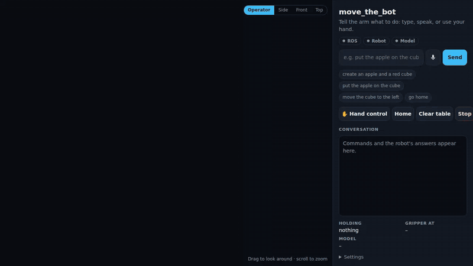
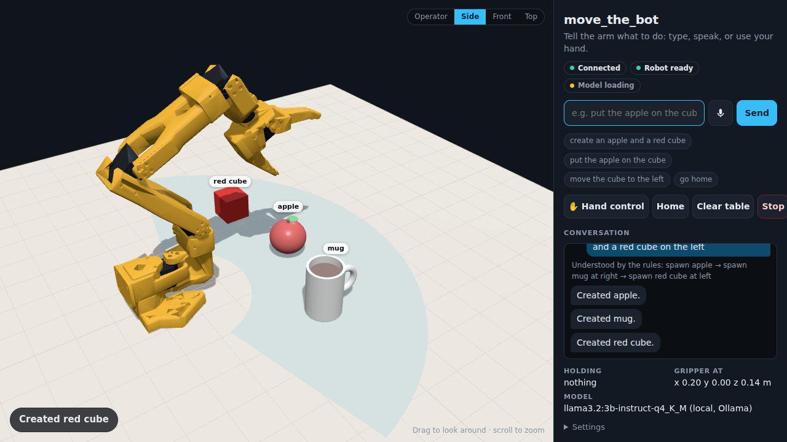
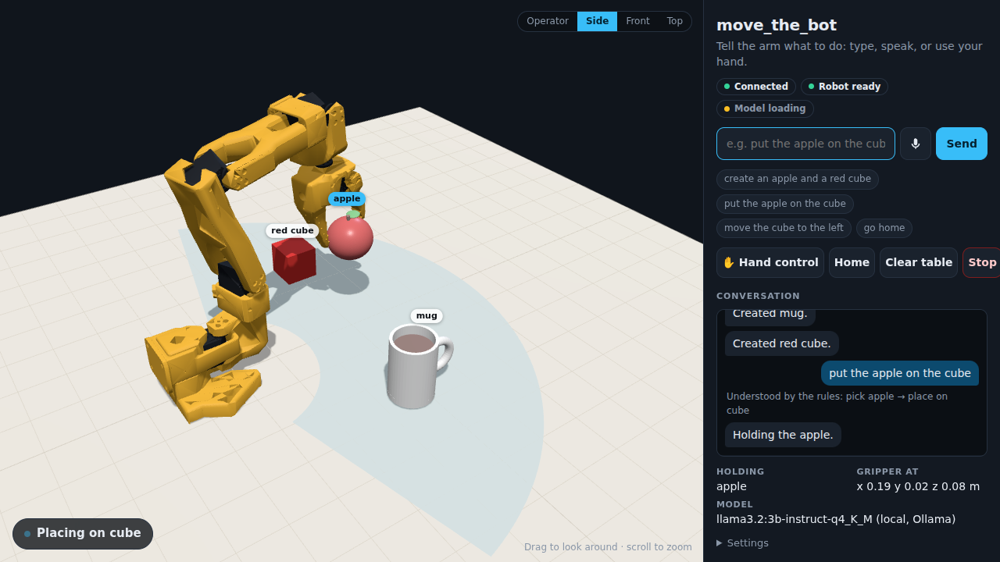
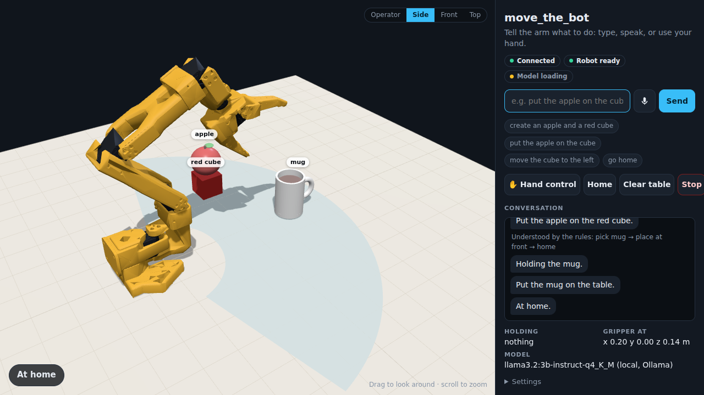
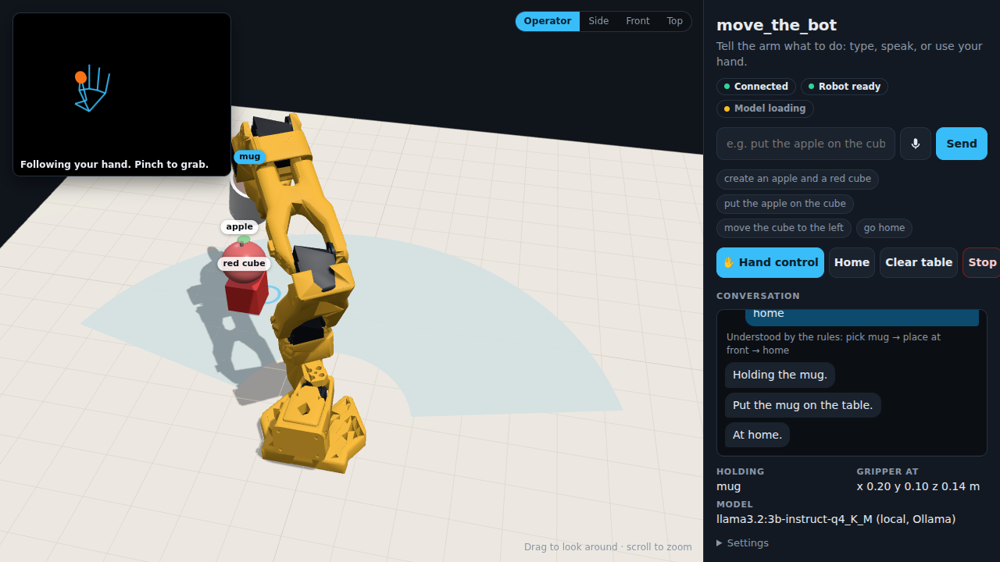
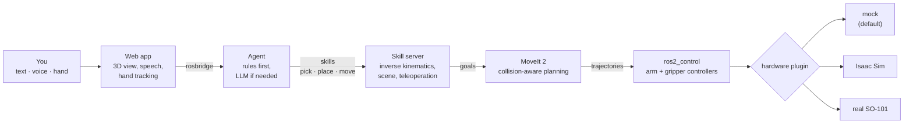

# move_the_bot

**Tell a robot arm what to do: type it, say it, or show it with your hand.**

[](https://github.com/gabripo/move_the_bot/actions/workflows/tests.yml)




"Create an apple and a red cube, then put the apple on the cube."
An agent turns the sentence into skills, **MoveIt 2** plans collision-free motions, and
**ros2_control** executes them on an [SO-101](https://github.com/TheRobotStudio/SO-ARM100) arm.
The arm is simulated by default. Because every command goes through ros2_control, the same
code drives **NVIDIA Isaac Sim** or the **real arm** by changing one launch argument.

Everything runs on your own computer in Docker, including the language model.

## What you can do

| | |
|---|---|
| **Type or speak** | "put the apple on the cube", "move the mug to the left, then go home" |
| **Use your hand** | Your webcam tracks one hand: the gripper follows it, a pinch grabs |
| **Mix them** | Steer by hand and say "create an apple here" |
| **Ask freely** | "I'm thirsty", "tidy up": a language model plans the steps |
| **Bring your own object** | Show it to the webcam (`./run.sh --scan`): one photo, four sides or a short video of one turn, started by a button, a thumbs-up or "scan my mug". [Idol](https://speridlabs.com/research/idol) turns it into a 3D object on the table. See [your own objects](docs/your-own-objects.md) |

| Objects from one sentence | Pick and place, planned by MoveIt |
|---|---|
|  |  |
| **Several steps from one request** | **Hand control: pinch to grab** |
|  |  |

These pictures are not mock-ups: a [GitHub workflow](.github/workflows/screenshots.yml) starts
the real stack after every change, runs the demo and saves what the browser shows.

## Quick start

You need [Docker](https://docs.docker.com/get-docker/) (Docker Desktop on macOS and Windows) and
about 8 GB of free disk space.

```bash
git clone https://github.com/gabripo/move_the_bot.git
cd move_the_bot
./run.sh
```

Open **http://localhost:8080** in Chrome or Edge. The first start builds the images (a few
minutes) and downloads a small language model (about 2 GB). Simple commands work right away;
the "Model" light turns green when free-form requests are ready too.

Stop with `./run.sh stop`. More options: `./run.sh --help`.

<details>
<summary>On Windows, or without the script</summary>

```bash
docker compose --profile ollama up -d      # start
docker compose --profile ollama down       # stop
```
</details>

### Things to try

1. `create an apple, a mug and a red cube`
2. `put the apple on the cube`
3. `move the mug to the left, then go home`
4. Click **Hand control**, allow the camera, move your hand, pinch over an object
5. `I'm thirsty` (needs the model: watch the conversation panel)

### A faster language model

The bundled model runs on the CPU inside Docker, which is slow on a laptop. Two better options:

| Option | How |
|---|---|
| Ollama on your computer (uses the GPU on a Mac or a GPU PC) | install [Ollama](https://ollama.com), then `./run.sh --host-ollama` |
| NVIDIA NIM (cloud, free credits) | put `NVIDIA_API_KEY=nvapi-...` in `.env`, then `./run.sh --nim` |

Any OpenAI-compatible endpoint works: see [.env.example](.env.example).

## How it works



1. **The web app** shows the robot from its real description (URDF) and sends your words, or
   your hand position, to ROS.
2. **The agent** understands everyday commands with fast built-in rules. Anything else goes to
   a language model, which must answer with a list of skills. Every skill is validated before
   the robot moves.
3. **The skill server** carries out skills such as `pick` and `place`: it computes joint
   angles, keeps track of the objects on the table, and asks MoveIt for each motion.
4. **MoveIt 2** plans around the table and the objects. A direct motion is tried first; if
   something is in the way, a sampling planner finds a path around it.
5. **ros2_control** executes the trajectory. What sits below it is a plugin: a simulated arm,
   Isaac Sim, or the real servos.

More detail: [docs/architecture.md](docs/architecture.md).

## From simulation to a real robot

| Step | What changes | Status |
|---|---|---|
| 1. Simulated arm | nothing: `./run.sh` | tested on every change |
| 2. Isaac Sim | `./run.sh --isaac`: joint commands and states travel over two ROS topics | interface tested with a stand-in for Isaac Sim |
| 3. Real SO-101 | `./run.sh --real`: Feetech servo driver on USB, plus a calibration file | wired up, not yet run on hardware by the author |

The steps, the calibration and the safety notes are in
[docs/real-hardware.md](docs/real-hardware.md). How the pieces map to the NVIDIA robotics
stack (Isaac Sim, Isaac ROS cuMotion, NIM, GR00T, Jetson) is in
[docs/nvidia-stack.md](docs/nvidia-stack.md). Which parts need which GPU is in
[docs/hardware-and-gpus.md](docs/hardware-and-gpus.md).

## Documentation

| | |
|---|---|
| [Architecture](docs/architecture.md) | the parts, the ROS topics, what happens when you give a command |
| [Skills](docs/skills.md) | the robot's vocabulary, how to call it from your own code, how to add a skill or an object |
| [Real hardware](docs/real-hardware.md) | Isaac Sim and the real SO-101, step by step |
| [NVIDIA stack](docs/nvidia-stack.md) | where Isaac Sim, cuMotion, NIM and GR00T fit |
| [Hardware and GPUs](docs/hardware-and-gpus.md) | what runs on a Mac, an AMD GPU, an NVIDIA GPU |
| [Development](docs/development.md) | running without Docker, tests, screenshots, troubleshooting |

## Tests

```bash
pip install numpy requests pytest && python -m pytest tests/unit      # no ROS needed
docker compose exec robot /ros_entrypoint.sh pytest /ros_ws/tests/e2e/test_robot.py   # the running stack
```

The end-to-end tests drive the real containers: MoveIt plans, the controllers execute, and a
browser test checks the page. See [docs/development.md](docs/development.md).

## Project layout

```
ros/move_the_bot/     the ROS 2 package
  robot/              SO-101 description (URDF, meshes) and its ros2_control hardware switch
  config/             controllers and MoveIt configuration
  launch/             bringup.launch.py starts everything
  move_the_bot/       Python: agent, language rules, LLM, skill server, kinematics, world model
web/                  the browser app (three.js, MediaPipe hand tracking)
models/               small 3D models of the objects
docker/               Dockerfiles and nginx configuration
tests/                unit tests, end-to-end tests, screenshot generator
docs/                 documentation and the generated pictures
```

## Credits

- SO-101 arm design and meshes: [TheRobotStudio/SO-ARM100](https://github.com/TheRobotStudio/SO-ARM100) (Apache-2.0)
- [MoveIt 2](https://moveit.ai), [ros2_control](https://control.ros.org), [three.js](https://threejs.org),
  [urdf-loader](https://github.com/gkjohnson/urdf-loaders), [MediaPipe](https://developers.google.com/mediapipe), [Ollama](https://ollama.com)

Built through agentic coding: the ideas and direction are mine; the code was written with AI coding agents.

## License

[MIT](LICENSE)
