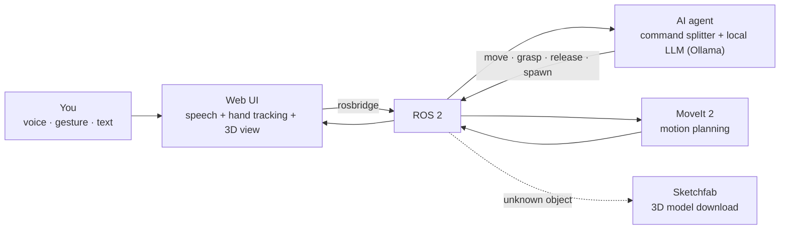

# move_the_bot

**Tell a robot arm what to do: by voice, with your hands, or by typing.** A local AI agent turns *"create an apple and grab it"* into planned, collision-aware arm motions.

[](https://github.com/gabripo/move_the_bot/actions/workflows/unit-tests.yml)


-000000)
[](LICENSE)

<!-- Demo: add docs/demo.gif (≈15 s: "create an apple" → "grab the apple") and uncomment the line below.
<p align="center"></p>
-->

## What it does

- **Three ways to give orders.** Speak (browser speech recognition, with a Whisper fallback), point with your hand (MediaPipe hand tracking), or type.
- **An AI agent that plans the steps.** A local LLM (Ollama, llama3.2, no cloud) breaks a sentence into actions: *move*, *grasp*, *release*, *spawn object*. A deterministic command splitter handles multi-step orders before the LLM is even asked.
- **Real robotics underneath.** ROS 2 and MoveIt 2 plan the arm's motion; the browser shows it live in 3D (Three.js), and RViz2 is available for engineers.
- **Any object you can name.** Built-in objects (apple, mug, bottle, …) spawn instantly; anything else is fetched from Sketchfab as a 3D model under 5 MB and scaled to fit.
- **Two agent back-ends, same robot.** A lightweight direct Ollama agent, or the OpenClaw agent framework, which is compatible with NVIDIA NemoClaw for deployment on NVIDIA hardware.

## How it works



Everything runs in Docker on one machine: `ollama`, `ros2`, `web`, `stt`, plus one or both agent stacks. Details are in [Launch options](#launch-options--differences--dependencies) and [PLAN_ARCHITECTURE.md](PLAN_ARCHITECTURE.md).

## Quick Start

### Prerequisites
- Docker Desktop 24+ with Docker Compose v2+
- 4 GB RAM minimum
- Ollama runs inside Docker (the included `ollama` service) — no local install needed

### Tutorials

| # | Topic | File |
|---|-------|------|
| 1 | Ollama Direct Agent (default, 4 containers) | [`tutorials/tutorial-1-ollama-agent.md`](tutorials/tutorial-1-ollama-agent.md) |
| 2 | OpenClaw Agent (6 containers, TS build required) | [`tutorials/tutorial-2-openclaw-agent.md`](tutorials/tutorial-2-openclaw-agent.md) |
| 3 | Both Agents (all 6 containers, side-by-side) | [`tutorials/tutorial-3-both-agents.md`](tutorials/tutorial-3-both-agents.md) |

Each tutorial includes build, launch, verify, example commands with "create an apple" / "grab the apple" scenarios, and cleanup steps.

Builtin spawnable objects: `apple`, `mug`, `bottle`, `cube`, `sphere`, `table`, `cylinder`, `can`. Unknown objects fall back to Sketchfab download (requires `SKETCHFAB_API_KEY`).

### Convenience Scripts

All launch configurations are available as executable scripts in `scripts/launch/`:

| Script | Purpose |
|--------|---------|
| `scripts/launch/ollama-agent.sh` | Tutorial 1 — Ollama direct agent |
| `scripts/launch/openclaw-agent.sh` | Tutorial 2 — OpenClaw agent (builds TS + launches) |
| `scripts/launch/all.sh` | Tutorial 3 — Both agents simultaneously |
| `scripts/launch/rviz2-macos.sh` | RViz2 visualization (macOS) |
| `scripts/launch/rviz2-linux.sh` | RViz2 visualization (Linux) |
| `scripts/launch/rviz2-windows.sh` | RViz2 visualization (Windows WSL2) |
| `scripts/launch/stop.sh` | Stop all running services |

Run any script from the project root: `./scripts/launch/ollama-agent.sh`

## Launch Options — Differences & Dependencies

The system supports three Docker Compose profiles, each starting a different set of services. All profiles share three always-on infrastructure services, then add profile-specific agent services on top.

### Service Architecture

```
┌─────────────────────────────────────────────────────────────┐
│                    PROFILE: ollama-agent                     │
│                                                             │
│  ollama ──→ ros2 ──→ web ←─→ stt  +  agent-core            │
│  (LLM)     (ROS 2)   (UI)   (ASR)   (direct Ollama)        │
└─────────────────────────────────────────────────────────────┘

┌─────────────────────────────────────────────────────────────┐
│                   PROFILE: openclaw-agent                    │
│                                                             │
│  ollama ──→ ros2 ──→ web ←─→ stt  +  openclaw              │
│  (LLM)     (ROS 2)   (UI)   (ASR)    (Gateway)              │
│                                       ─→ perception-bridge  │
│                                          (forwarder + SDK)   │
└─────────────────────────────────────────────────────────────┘

┌─────────────────────────────────────────────────────────────┐
│                      PROFILE: all                            │
│                                                             │
│  Both agent stacks run simultaneously — only one will       │
│  actuate the arm at a time (both publish to same topics).   │
└─────────────────────────────────────────────────────────────┘
```

### Service Dependency Graph

```
                     ┌──────────┐
                     │  ollama  │  (LLM — llama3.2)
                     └────┬─────┘
                          │  wait for healthy
                          ▼
                ┌─────────────────┐
                │      ros2       │  (ROS 2 + rosbridge + all actuation nodes)
                └────────┬────────┘
                     ┌───┴────┬─────┐
                     ▼        ▼     ▼
              ┌──────────┐ ┌────┐ ┌──────┐
              │   web    │ │ stt│ │agent │  (profile-specific)
              │ (nginx)  │ │(ASR)│ │-core │
              └──────────┘ └────┘ └──────┘
```

### Profile Comparison

| Service | `ollama-agent` | `openclaw-agent` | `all` | Description |
|---------|:---:|:---:|:---:|-------------|
| `ollama` | ✓ | ✓ | ✓ | LLM server with llama3.2. Pulls model on first start. |
| `ros2` | ✓ | ✓ | ✓ | ROS 2 Humble container. Runs all actuation nodes: `mock_motion_planning_node` (MoveIt 2 motion planning), `virtual_scene_node` (table/world markers), `object_spawn_node` (3D model spawner), `move_group` (MoveIt 2 planning service), `rosbridge_websocket` (WebSocket API on :9090), `robot_state_publisher` (URDF). |
| `web` | ✓ | ✓ | ✓ | nginx:alpine serving the frontend at :80. Reverse-proxies `/ws/` → ros2:9090 for WebSocket, `/stt/` → stt:8000 for speech-to-text. |
| `stt` | ✓ | ✓ | ✓ | **Speech-to-text service.** Runs OpenAI Whisper tiny model in a FastAPI server. Accepts audio uploads at POST `/transcribe`, returns transcribed text. Used as fallback for Firefox (which lacks native `SpeechRecognition`). |
| `agent-core` | ✓ | — | ✓ | **Ollama direct agent.** A Python ROS 2 node that subscribes to `/spatial_coords` and `/voice_commands`, builds a prompt, queries Ollama's HTTP API, parses the JSON response, and publishes to `/target_goal`, `/grasp_command`, or `/object_spawn`. Uses a rule-based keyword parser as a fast-path, with Ollama fallback. See [Ollama Agent Internals](PLAN_ARCHITECTURE.md#ollama-agent-internals-agentic_core_nodepy) in `PLAN_ARCHITECTURE.md`. Minimal dependencies — single container, no extra framework. |
| `openclaw` | — | ✓ | ✓ | **OpenClaw Gateway.** A Node.js service running the OpenClaw agent framework with a custom tool plugin (`arm_move`, `arm_grasp`, `arm_release`, `spawn_object`). Connects to Ollama for LLM inference. Listens on WebSocket port 1455 for the perception forwarder. |
| `perception-bridge` | — | ✓ | ✓ | **Perception forwarder + SDK bridge.** Two components: a Python ROS 2 node (`perception_forwarder.py`) that forwards `/spatial_coords` and `/voice_commands` via stdin to a Node.js bridge process (`forwarder_bridge.ts`), which sends them to the OpenClaw Gateway using `openclaw-sdk`. Supports an alternative direct WebSocket backend (`perception_forwarder_ws.py`) via `OPENCLAW_FORWARDER_BACKEND=websocket`. |

### Service Dependencies

| Service | Depends On | Condition |
|---------|-----------|-----------|
| `ros2` | `ollama` | service started |
| `web` | `ros2`, `stt` | service started |
| `stt` | _(none)_ | always |
| `agent-core` | `ros2` | service started |
| `openclaw` | `ros2` | service started |
| `perception-bridge` | `openclaw`, `ros2` | service started |

### Choosing a Profile

| Use Case | Profile | Why |
|----------|---------|-----|
| Local development, testing | `ollama-agent` | Simpler stack (only 5 containers), fewer dependencies, faster startup. The direct agent queries Ollama directly without an intermediate framework. |
| Production, full agent framework | `openclaw-agent` | OpenClaw provides memory, multi-channel support, tool sandboxing, and is compatible with NemoClaw for hardware deployment. |
| Side-by-side comparison | `all` | Both agents run simultaneously. Useful for development and debugging, but only one should actuate at a time. |

### Launch File Options (Inside the ROS 2 Container)

The `deploy.launch.py` and `visualize.launch.py` ROS 2 launch files control which nodes start inside the `ros2` container:

| Launch File | Nodes | When to Use |
|-------------|-------|-------------|
| `deploy.launch.py` | mock_motion_planning, move_group, virtual_scene, object_spawn, rosbridge_websocket, robot_state_publisher | Default. Headless deployment (no GUI). Used by `docker-compose.yml`. |
| `visualize.launch.py` | Same as above + **rviz2** (MotionPlanning plugin) | Development. Opens RViz2 for 3D visualization of the arm, planned trajectories, and planning scene. Requires X11 forwarding. |
| `move_group.launch.py` | robot_state_publisher + **move_group** | Starts the MoveIt 2 planning service standalone. |
| `moveit_rviz.launch.py` | move_group + **mock_motion_planning** + **rviz2** (MotionPlanning plugin) | MoveIt 2 planning with RViz2 visualization of planned paths and the planning scene. |

### Environment Variables

| Variable | Default | Profiles | Description |
|----------|---------|----------|-------------|
| `SKETCHFAB_API_KEY` | _(unset)_ | all | API key for Sketchfab Download API. Enables fallback 3D model downloads for unknown objects. |
| `OPENCLAW_FORWARDER_BACKEND` | `sdk` | openclaw-agent | `sdk` uses the Node.js openclaw-sdk bridge; `websocket` uses direct Python WebSocket to the Gateway. |
| `OLLAMA_URL` | `http://ollama:11434/api/generate` | ollama-agent | Ollama API endpoint. Change to `http://host.docker.internal:11434/api/generate` to use a host-side Ollama. |
| `OLLAMA_MODEL` | `llama3.2` | ollama-agent | Ollama model tag. Light→capable: `llama3.2:3b-instruct-q4_K_M`, `llama3.2:3b`, `llama3.1:8b-instruct-q4_K_M`, `llama3.1:8b`. Auto-pulled on startup. |
| `ROS_DOMAIN_ID` | `42` | all | ROS 2 DDS domain ID. Change if multiple ROS 2 stacks run on the same network. |

## MoveIt 2 Motion Planning

The system includes a `mock_motion_planning_node` that uses MoveIt 2's `MoveGroupCommander` to compute Cartesian or joint-space plans from a `/target_goal` (PoseStamped) and replays them on `/joint_states`. The `moveit_rviz.launch.py` launches `move_group`, the planning node, and RViz2 with the MoveIt MotionPlanning plugin for trajectory and planning-scene visualization. See [docs/moveit-planning.md](docs/moveit-planning.md).

## RViz2 Visualization

See [docs/rviz2-visualization.md](docs/rviz2-visualization.md) for platform-specific instructions (macOS VNC, Linux X11, Windows WSL2) and troubleshooting.

## Architecture

See `PLAN_ARCHITECTURE.md` for full architecture documentation.

## Documentation

| File | Content |
|------|---------|
| `PLAN_ARCHITECTURE.md` | System architecture and data flow |
| `PLAN_DESIGN_CHOICES.md` | Design decisions and rationale |
| `PLAN_PROMPTS.md` | All LLM prompts and skill definitions |
| `PLAN_TEST_STRATEGY.md` | Test plan and coverage |
| `docs/rviz2-visualization.md` | RViz2 setup for macOS / Linux / Windows |
| `docs/moveit-planning.md` | MoveIt 2 motion planning integration |

## Development

```bash
# Generate placeholder 3D models
python3 scripts/generate_placeholder_glbs.py

# Run unit tests (no Docker needed)
pip install pytest requests && pytest tests/unit/

# Run integration tests (requires running stack)
docker compose -f docker/docker-compose.yml --profile ollama-agent up -d
pytest tests/integration/
docker compose down

# Run tests with mock Ollama (CI)
docker compose -f docker-compose.test.yml up --abort-on-container-exit --build
```

## Environment Variables

| Variable | Default | Description |
|----------|---------|-------------|
| `SKETCHFAB_API_KEY` | _(unset)_ | API key for 3D model fallback downloads |
| `OPENCLAW_FORWARDER_BACKEND` | `sdk` | `sdk` (Node.js bridge) or `websocket` (direct) |
| `OLLAMA_URL` | `http://ollama:11434/api/generate` | Ollama API endpoint |
| `OLLAMA_MODEL` | `llama3.2` | Ollama model tag (e.g. `llama3.2:3b-instruct-q4_K_M`, `llama3.1:8b`) |
| `ROS_DOMAIN_ID` | `42` | ROS 2 DDS domain |
