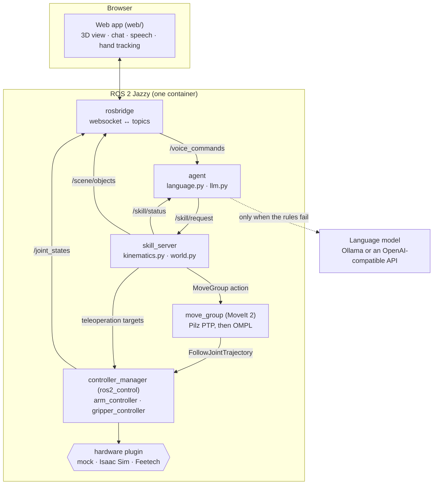

# Architecture

How a sentence, or a hand in front of the webcam, becomes motion of the arm.

## The parts

| Part | File | What it does |
|---|---|---|
| Web app | `web/` | Draws the robot from its URDF and moves it with `/joint_states`. Sends typed or spoken commands. Tracks one hand with MediaPipe and sends where it is. |
| Agent | `move_the_bot/agent_node.py` | Turns a command into skills and runs them one by one, waiting for each to finish. |
| Language rules | `move_the_bot/language.py` | Understands everyday commands instantly, without a model. |
| LLM fallback | `move_the_bot/llm.py` | Asks a language model when the rules do not understand. The answer must be a JSON list of skills and is validated. |
| Skill server | `move_the_bot/skill_server.py` | Carries out skills: computes joint angles, keeps the table-top world, sends motions to MoveIt, handles teleoperation. |
| Kinematics | `move_the_bot/kinematics.py` | Forward and inverse kinematics computed from the URDF. |
| World | `move_the_bot/world.py` | Which objects exist, where they are, what the gripper holds. |
| MoveIt 2 | `config/` | Plans collision-free trajectories and hands them to the controllers. |
| ros2_control | `config/ros2_controllers.yaml`, `robot/so101.urdf.xacro` | Runs the arm and gripper controllers on top of a hardware plugin. |

`language.py`, `llm.py`, `skills.py`, `world.py` and `kinematics.py` do not import ROS, so they
are unit-tested on their own and can be reused elsewhere.

## What happens when you say "put the apple on the cube"

1. The browser publishes the text on `/voice_commands`.
2. The agent's rules split it into two skills:
   `{"skill": "pick", "object": "apple"}` and
   `{"skill": "place", "at": {"object": "cube", "relation": "on"}}`.
3. The agent sends the first skill on `/skill/request` and waits for `/skill/status`.
4. The skill server runs `pick`:
   - finds the apple in its world model and a grasp point on it;
   - solves inverse kinematics for the grasp pose and for a pose straight above it;
   - opens the gripper;
   - asks MoveIt to move above the apple (the apple and the table are obstacles);
   - takes the apple out of the obstacle list, moves down, closes the gripper to the apple's width;
   - attaches the apple to the gripper in MoveIt's world, so later plans avoid hitting things with it;
   - moves back up.
5. `place` works the same way in reverse, and the apple comes to rest on the cube.
6. All the while the browser receives `/joint_states` and `/scene/objects` and redraws.

## Two planners

Each arm motion is requested as a joint-space goal.

1. **Pilz PTP** is tried first. It gives one smooth, predictable motion and checks it for collisions.
2. If that motion would hit something, **OMPL RRTConnect** searches for a path around the obstacle.

So free-space moves look deliberate, and the arm still finds its way around a bottle in the middle
of the table.

## Why the arm has its own inverse kinematics

The SO-101 has 5 joints. It can reach a position, and choose how steeply the gripper points down,
but not an arbitrary orientation. Generic solvers that expect 6 joints either fail or return a
pose that does not grasp well. `kinematics.py` solves for "this position, with the gripper as
close to straight down as the arm allows", which is what picking from a table needs. MoveIt then
plans the path to those joint angles.

## Hand teleoperation

The browser turns hand landmarks into a target for the gripper (`web/js/hand.js`):

| Hand | Robot |
|---|---|
| left / right on screen | gripper left / right |
| up / down | gripper up / down |
| closer to the camera | gripper further forward |
| pinch thumb and index finger | close the gripper |

The skill server follows the target at 15 Hz: it limits the speed, keeps the gripper above the
table and inside the arm's reach, solves inverse kinematics starting from the previous solution
and streams the joint targets to the arm controller. Closing the gripper around an object picks
it up; opening it lets go.

Teleoperation does not go through MoveIt: there is no time to plan at 15 Hz, so the arm does not
avoid objects while you steer it by hand. Spoken or typed commands still work during
teleoperation ("create an apple here" puts it where your hand points) and take over the arm
until they finish.

## ROS interface

| Topic | Type | Direction | Content |
|---|---|---|---|
| `/voice_commands` | `std_msgs/String` | browser → agent | a command in plain language |
| `/agent_log` | `std_msgs/String` (JSON) | agent → browser | `{"role": "user" \| "robot" \| "info" \| "error", "text": "..."}` |
| `/agent/state` | `std_msgs/String` (JSON) | agent → browser | model name, ready, busy |
| `/agent/llm_only` | `std_msgs/Bool` | browser → agent | skip the rules, always ask the model |
| `/skill/request` | `std_msgs/String` (JSON) | anyone → skill server | one skill, see [skills.md](skills.md) |
| `/skill/status` | `std_msgs/String` (JSON) | skill server → anyone | `running`, then `succeeded`, `failed` or `stopped` with a message |
| `/skill/state` | `std_msgs/String` (JSON) | skill server → anyone | busy, holding, gripper position, 5 Hz |
| `/scene/objects` | `std_msgs/String` (JSON) | skill server → browser | every object: name, shape, size, pose, held |
| `/teleop/enable` | `std_msgs/Bool` | browser → skill server | switch hand control on or off |
| `/teleop/target` | `geometry_msgs/Point` | browser → skill server | where the jaws should be, in metres |
| `/teleop/gripper` | `std_msgs/Float32` | browser → skill server | 0 = closed, 1 = open |
| `/joint_states` | `sensor_msgs/JointState` | ros2_control → all | the arm's joint angles |

Standard interfaces used underneath: `/move_action` (MoveIt), `/apply_planning_scene`,
`/arm_controller/follow_joint_trajectory`, `/gripper_controller/follow_joint_trajectory`.

Skill requests are JSON in a `String` message on purpose: the browser, a shell one-liner and an
LLM can all produce them without generated message types. For a larger system, a ROS action
would be the natural next step.

## Coordinates

One frame everywhere: the robot's `base_link`, in metres. **x** points forward, **y** to the
robot's left, **z** up; the table is z = 0. The browser draws in the same coordinates, so a
position on screen is the same number in ROS.
