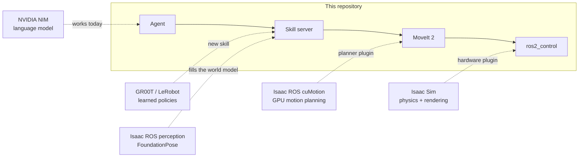

# Where this fits in the NVIDIA robotics stack

move_the_bot is built on the standard ROS 2 interfaces (ros2_control, MoveIt 2, joint
trajectories). Those are the interfaces NVIDIA's robotics software plugs into, so each NVIDIA
component has a specific place to connect.



| NVIDIA component | Connects at | Status here | What is left to do |
|---|---|---|---|
| **NIM** (hosted or self-hosted LLMs) | the agent's LLM fallback | **works**: `./run.sh --nim` | nothing |
| **Isaac Sim** | ros2_control hardware plugin | **interface ready and tested** with a stand-in | build the scene and action graph in Isaac Sim ([real-hardware.md](real-hardware.md)) |
| **Isaac ROS cuMotion** | MoveIt planning pipeline | not included | add the plugin and a robot description for cuMotion |
| **Isaac ROS perception** | the world model | not included | a node that writes detected objects into the scene |
| **GR00T / LeRobot policies** | a new skill, or the teleoperation path | not included | record demonstrations, fine-tune, add a `policy` skill |
| **Jetson** | the robot container | image builds for arm64 | run it on a Jetson next to the arm |

Only the first two rows are implemented. The rest is described so that you can see how much,
or how little, each step takes.

## NIM as the language model

The agent talks to any OpenAI-compatible API. NVIDIA's hosted endpoint is the default for that
mode:

```bash
echo "NVIDIA_API_KEY=nvapi-..." >> .env     # from https://build.nvidia.com
./run.sh --nim
```

Change the model with `OPENAI_MODEL` (default `meta/llama-3.1-8b-instruct`). A self-hosted NIM
container works the same way: point `OPENAI_BASE_URL` at it.

The model only ever proposes skills as JSON. `skills.py` validates them before anything moves,
whichever model is used.

## Isaac Sim as the robot

With `hardware:=isaac`, ros2_control publishes joint commands on `/isaac_joint_commands` and
reads `/isaac_joint_states`. This is the topic-based ros2_control pattern that Isaac Sim's own
MoveIt tutorial uses. Steps: [real-hardware.md](real-hardware.md#step-1-isaac-sim).

What Isaac Sim adds over the built-in mock arm: physics (objects can slip or fall), rendered
camera images for perception, and synthetic data for training.

## cuMotion as the planner

[Isaac ROS cuMotion](https://nvidia-isaac-ros.github.io/repositories_and_packages/isaac_ros_cumotion/isaac_ros_cumotion_moveit/index.html)
is a GPU-accelerated motion planner that ships as a MoveIt 2 planning plugin. Isaac ROS 4
targets ROS 2 Jazzy, the distribution used here.

1. Run on an NVIDIA GPU or a Jetson, inside the Isaac ROS development container.
2. Generate a cuMotion robot description (XRDF: collision spheres) for the SO-101 from the URDF.
3. Add `isaac_ros_cumotion` as a third planning pipeline in `bringup.launch.py`, next to Pilz
   and OMPL.
4. In `skill_server.py`, `_move_joints()` already tries a list of planners in order: put
   cuMotion in that list.

The skill server sends joint-space goals with the scene's obstacles, which is what cuMotion
expects from MoveIt.

## GR00T and LeRobot

The SO-101 is the reference arm of [LeRobot](https://huggingface.co/docs/lerobot/so101), and
NVIDIA publishes guides for fine-tuning GR00T N1.x on it
([example](https://huggingface.co/blog/nvidia/gr00t-n1-5-so101-tuning),
[sim-to-real course](https://docs.nvidia.com/learning/physical-ai/sim-to-real-so-101/latest/10-groot.html)).

How a learned policy would fit here:

1. **Collect demonstrations.** Record joint states, commands and camera images while
   teleoperating (LeRobot's own recorder with a leader arm, or this project's hand
   teleoperation plus a `ros2 bag`, converted to a LeRobot dataset).
2. **Fine-tune** GR00T on an NVIDIA GPU (local or cloud).
3. **Add a `policy` skill**: a skill that, while active, feeds camera images and joint states to
   the policy and streams its joint targets to the arm controller. This is the same path hand
   teleoperation uses today (`/arm_controller/joint_trajectory`).
4. **Let the agent choose**: planned motion (MoveIt) for tasks that are easy to describe
   geometrically, the learned policy for the ones that are not.

## Jetson

The robot image is based on `ros:jazzy-ros-base`, which is published for arm64, so it builds on
a Jetson. A sensible split for a real setup: Jetson next to the arm running the robot container
(and cuMotion, perception), the web app opened from any laptop on the network.
