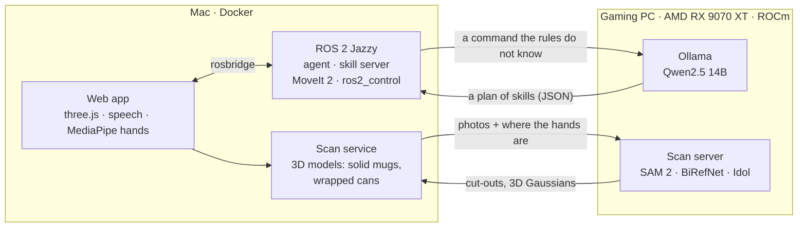

# Overview: what move_the_bot is, and what it is built with

move_the_bot is a robot arm (the SO-101) you can talk to, steer with your hand and show new
objects to. A web app shows the arm and the table in 3D; you type or say what you want ("put the
apple on the cube", "I'm thirsty!"), point at a spot, or show an object to the webcam, and the
arm plans its motion around everything on the table and carries it out, in simulation or on the
real arm.

It runs on two computers in a home network. A **Mac** runs the robot and the web app, in Docker.
A **gaming PC** with an AMD GPU runs the AI models that need a GPU: the language model, the
object cut-outs and the image-to-3D model. Without the PC everything but those still works, and
the PC's AI is off by default, so its GPU stays free for games.

The two computers talk in plain HTTP and JSON (`OLLAMA_URL` and `IDOL_URL` in `.env`).

## The technologies, feature by feature

### Voice control

- **Speech to text**: the browser's own speech recognition (Chrome, Edge, Safari), or
  **OpenAI Whisper** (`small.en`) in this project's `stt` container, so nothing leaves the
  computer (`docker/stt_server.py`, `web/js/speech.js`).
- **Understanding**: everyday commands are read by **rules** written in Python
  (`move_the_bot/language.py`), instantly. Anything else goes to a **local language model**,
  **Qwen2.5 14B** served by **Ollama** on the gaming PC (any OpenAI-compatible endpoint, such as
  NVIDIA NIM, works too). It must answer with a list of skills in JSON, and every skill is
  validated before the robot moves (`move_the_bot/llm.py`, `skills.py`). It is told what is on
  the table and which objects you scanned: "I'm thirsty!" brings the mug, "I'm still thirsty!"
  your scanned drink.

### Motion planning

- **ROS 2 Jazzy** runs the robot side; the browser reaches it through **rosbridge**.
- **MoveIt 2** plans every motion: the **Pilz industrial motion planner** (PTP) first, for a
  smooth direct move, then **OMPL RRTConnect**, a sampling planner, when something is in the way.
  Inverse kinematics: MoveIt's **KDL** solver (`config/kinematics.yaml`).
- **ros2_control** executes the trajectories, with a hardware plugin below it: a simulated arm
  (default), **NVIDIA Isaac Sim**, or the real **SO-101**'s Feetech servos.
- The skill server (`move_the_bot/skill_server.py`) turns skills such as `pick` and `place` into
  MoveIt goals; the web app draws the arm from its URDF with **three.js**.

### Obstacle avoidance

- Every object on the table is a collision shape in **MoveIt's planning scene**, a few
  millimetres smaller than drawn, so resting on the table is not a collision.
- An object in the gripper is **attached** to it, so MoveIt plans for the arm and the object as
  one.
- When the direct motion would hit something, **OMPL RRTConnect** finds a way around it.
- Placing keeps a free gap around every object and stays within the arm's reach
  (`move_the_bot/world.py`).

### Hand control

- **Google MediaPipe Hand Landmarker** runs in the browser (WebAssembly, on the GPU when it can)
  and finds 21 points on each hand in the webcam picture; no video leaves the computer
  (`web/js/hand.js`).
- The hand's position becomes the gripper's target, a pinch closes the gripper, a thumbs-up
  starts a scan. The same tracker tells the scanner where your hands are in each photo, so they
  are left out of the 3D model.

### 3D generation (bring your own object)

- **Idol** by Sperid Labs, an open image-to-3D model: each photo becomes 262,144 **3D Gaussians**
  (small coloured, see-through blobs), on the gaming PC's GPU with **PyTorch on ROCm**.
- **Meta SAM 2** (segment anything) cuts the object out of each photo first, told where your
  hands are; **BiRefNet** (part of Idol) refines its edges.
- Four photos a quarter turn apart are lined up and merged (NumPy). Round things get a better
  shape than points: a mug becomes a solid cylinder wearing its print, with a fitted handle, and a
  can skips Idol: its photos are wrapped around a cylinder of the measured proportions
  (`scripts/solid_mug.py`). The result is a **glTF (GLB)** model the 3D view draws and the robot
  grasps at the object's real size.
- Details: [your own objects](your-own-objects.md).

### Around it

- **Docker Compose** starts everything on the Mac (`./run.sh`); `./record-demo.sh` sets up a
  recording.
- On the PC (Bazzite Linux), **Podman** quadlets run Ollama and the scan server, and an
  **ai-switch** tray icon turns the AI on and off.

More: [architecture](architecture.md) (the parts and the ROS topics), [skills](skills.md),
[hardware and GPUs](hardware-and-gpus.md), [development](development.md).
