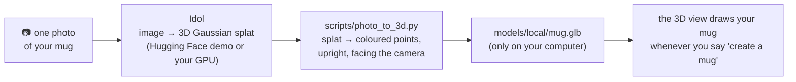

# Your own objects, from one photo

Put your own mug, or any small object, on the robot's table: one photo becomes its 3D model.
The photo is turned into 3D by **Idol**, an open image-to-3D model by Speridlabs
([research page](https://speridlabs.com/research/idol) ·
[code](https://github.com/speridlabs/idol-sdk) ·
[demo](https://huggingface.co/spaces/speridlabs/idol)).



## How it works

1. **Idol** turns one picture into a 3D Gaussian splat: a few hundred thousand small, soft,
   coloured blobs that together look like the object from every side, including the sides the
   photo does not show (Idol invents them).
2. **`scripts/photo_to_3d.py`** turns the splat into coloured points. It drops faint and oversized
   blobs and stray points, stands the object upright on its footprint, turns the photographed side
   towards the camera of the recording view and writes `models/local/<name>.glb`.
3. **The robot** looks for `models/local/<name>.glb` before its own models, and the browser draws
   the points with a dark core inside, so the gaps between them show the object, not the table.

The look changes, the physics do not: the robot still plans and grasps with the object's simple
shape from the catalogue (a mug is a cylinder 6 cm wide and 7 cm tall, see
`move_the_bot/world.py`), and the model is scaled to that height.

## Step by step

**With the script**, which sends the photo to Idol's public demo:

```bash
pip install numpy gradio_client
python3 scripts/photo_to_3d.py --image my-mug.jpg --name mug
./run.sh --rebuild
```

Then say or type "create a mug". `--gaussians 524,288` asks for more detail.

**With the demo in your browser**, for example when its free quota for anonymous use is spent
(see below): open the [demo](https://huggingface.co/spaces/speridlabs/idol), upload the photo,
choose **Real photo**, run it and download the `.ply` file. Then:

```bash
python3 scripts/photo_to_3d.py --ply ~/Downloads/idol-seed42-262144.ply --name mug
./run.sh --rebuild
```

**On your own GPU**, with the [Idol SDK](https://github.com/speridlabs/idol-sdk) (about 7 GB of
video memory; the first run downloads the weights, which needs access to DINOv3 and FLUX.2 on
Hugging Face):

```bash
python -m idol.sample --image my-mug.jpg --mode real
python3 scripts/photo_to_3d.py --ply my-mug.ply --name mug
```

## A good photo

- One object, the whole of it, on a plain light background, evenly lit. A shop's product photo
  works well.
- From the side, at about the height of the object's middle. For a mug, the handle to one side.
- About 1000 pixels across the object is plenty: Idol works at roughly that size.

## Good to know

- **The back is invented.** A print on the front may come back on the back as well.
- **Free demo quota.** The demo runs on Hugging Face's shared GPUs, which give a short daily
  quota to visitors who are not logged in; a run asks for 3 minutes of it. Logged in to Hugging
  Face in your browser you get more, or run Idol on your own GPU.
- **Turning it.** `--yaw` turns the photographed side (default: towards the recording camera of
  `?rec`); `--min-opacity` keeps fewer, more solid points (higher) or more, fainter ones (lower).
- **Keep it on your computer.** `models/local` is never committed. Photos and models of branded
  products, such as a mug with licensed artwork, are fine for your own demo but do not belong in
  a public repository.
