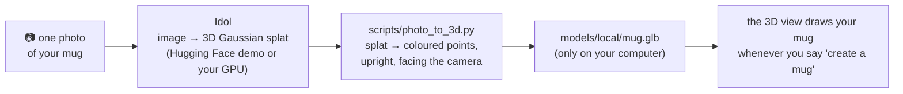

# Your own objects, from one photo

Put your own mug, or any small object, on the robot's table: one photo becomes its 3D model,
from a file or live from the webcam.
The photo is turned into 3D by **Idol**, an open image-to-3D model by Speridlabs
([research page](https://speridlabs.com/research/idol) ·
[code](https://github.com/speridlabs/idol-sdk) ·
[demo](https://huggingface.co/spaces/speridlabs/idol)).



## How it works

1. **Idol** turns one picture into a 3D Gaussian splat: a few hundred thousand small, soft,
   coloured blobs that together look like the object from every side, including the sides the
   photo does not show (Idol invents them).
2. **`scripts/photo_to_3d.py`** turns the splat into coloured points. It drops faint and oversized
   blobs and stray points, stands the object upright on its footprint, turns the photographed side
   towards the camera of the recording view and writes `models/local/<name>.glb`.
3. **The robot** looks for `models/local/<name>.glb` before its own models, and the browser draws
   the points with a dark core inside, so the gaps between them show the object, not the table.

The look changes, the physics do not: the robot still plans and grasps with the object's simple
shape from the catalogue (a mug is a cylinder 6 cm wide and 7 cm tall, see
`move_the_bot/world.py`), and the model is scaled to that height.

## Step by step

**With the script**, which sends the photo to Idol's public demo:

```bash
pip install numpy gradio_client
python3 scripts/photo_to_3d.py --image my-mug.jpg --name mug
./run.sh --rebuild
```

Then say or type "create a mug". `--gaussians 524,288` asks for more detail.

**With the demo in your browser**, for example when its free quota for anonymous use is spent
(see below): open the [demo](https://huggingface.co/spaces/speridlabs/idol), upload the photo,
choose **Real photo**, run it and download the `.ply` file. Then:

```bash
python3 scripts/photo_to_3d.py --ply ~/Downloads/idol-seed42-262144.ply --name mug
./run.sh --rebuild
```

**On your own GPU**, with the [Idol SDK](https://github.com/speridlabs/idol-sdk) (about 7 GB of
video memory; the first run downloads the weights, which needs access to DINOv3 and FLUX.2 on
Hugging Face):

```bash
python -m idol.sample --image my-mug.jpg --mode real
python3 scripts/photo_to_3d.py --ply my-mug.ply --name mug
```

## Scan with the webcam (optional)

The same idea, live: show an object to the webcam and it joins the table. It is off by default;
start it with:

```bash
./run.sh --scan
```

A **📷 Scan** button appears next to Stop.

1. Click it and hold the object inside the square, ideally in front of a plain background.
2. Type what it is ("stapler") and how tall it is: a photo cannot tell how big something is.
   Width and depth follow from the model's proportions.
3. Click **Scan**. The photo goes to the scanner (`docker/scan_server.py`), Idol makes the 3D
   object, and the page says "create a stapler". Afterwards "create a stapler" works any time,
   without scanning again.

The robot plans and grasps a scanned object as a box of that size, so objects up to about 9 cm
across fit its gripper. A scan with the name of a built-in object ("apple") replaces the built-in
model; `models/local` still wins over both.

### Where Idol runs

| `IDOL_BACKEND` | Where Idol runs | Needs |
|---|---|---|
| `demo` (default) | Idol's public demo on Hugging Face | the internet; a short free daily quota, more with `HF_TOKEN` in `.env` |
| `remote` | a scan server on a GPU PC in your network, at `IDOL_URL` | that PC: the Idol SDK and about 8 GB of video memory |
| `local` | inside the scanner container | a GPU the container can use and the Idol SDK installed (not in the default image) |
| `file` | nowhere: always the splat at `IDOL_FILE` | nothing; for tests and offline demos |

### Why not Ollama

Ollama serves language models (GGUF files run by llama.cpp). Idol is a different kind of model: a
diffusion transformer with an image encoder, a background remover and decoders that output 3D
Gaussians, all in PyTorch. So it gets its own small server, which you can run next to Ollama on
the same GPU PC.

### A scan server on your GPU PC

[`docker/idol-server/idol-server.sh`](../docker/idol-server/idol-server.sh) sets one up next to
Ollama, the same way [`ollama-server.sh`](hardware-and-gpus.md#a-gpu-pc-in-your-network) does: a
container with PyTorch for your AMD GPU (ROCm), Idol and this project's scan server, run by Podman
as a system service on port 8001. Written for Bazzite; other Linux systems with Podman work too.

1. With your Hugging Face account, accept the terms of the two models Idol reads images with,
   [DINOv3](https://huggingface.co/facebook/dinov3-vith16plus-pretrain-lvd1689m) and
   [FLUX.2-dev](https://huggingface.co/black-forest-labs/FLUX.2-dev) (only its VAE is used; check
   both licences for your use), and create a read token at
   [huggingface.co/settings/tokens](https://huggingface.co/settings/tokens).
2. On the GPU PC:

   ```bash
   curl -fsSLO https://raw.githubusercontent.com/gabripo/move_the_bot/master/docker/idol-server/idol-server.sh
   bash idol-server.sh install        # builds the image (several GB, once) and starts the service
   idol-server login                  # paste the token
   idol-server test                   # the first run also downloads Idol (about 3 GB)
   ```

   `IDOL_GFX` selects the GPU family (default `gfx1201`, the Radeon RX 9070 series; `gfx1100` for
   the RX 7900 series).
3. On the computer that runs move_the_bot, in `.env` (the address `idol-server test` prints):

   ```bash
   IDOL_BACKEND=remote
   IDOL_URL=http://192.168.1.50:8001
   ```

   Then `./run.sh --scan`.

The GPU is shared: before each scan the server asks Ollama on the same PC to unload its model
(a 14B model and Idol do not fit together in 16 GB; the next language request loads it again),
and after the scan it frees the video memory, so games get it back. Like Ollama, the server has
no password: use it only in a network you trust. Idol's authors run it on NVIDIA GPUs and Apple
Silicon; on AMD GPUs its NVIDIA-only speed-ups are switched off (`IDOL_OPTIMIZE=auto`).

### Testing the scanner

Without Idol: a synthetic splat stands in for it, so the camera, the upload, the conversion and
"create a …" are all tested (GitHub does this on every pull request).

```bash
python3 tests/e2e/make_test_splat.py test-splat.ply
docker compose cp test-splat.ply robot:/models/cache/test-splat.ply
IDOL_BACKEND=file IDOL_FILE=/models/cache/test-splat.ply docker compose --profile scan up -d --build scan
cd tests/e2e && CHECK_SCAN=1 node browser_test.mjs
```

## A good photo

- One object, the whole of it, on a plain light background, evenly lit. A shop's product photo
  works well.
- From the side, at about the height of the object's middle. For a mug, the handle to one side.
- About 1000 pixels across the object is plenty: Idol works at roughly that size.

## Good to know

- **The back is invented.** A print on the front may come back on the back as well.
- **Free demo quota.** The demo runs on Hugging Face's shared GPUs, which give a short daily
  quota to visitors who are not logged in; a run asks for 3 minutes of it. Logged in to Hugging
  Face in your browser you get more, or run Idol on your own GPU.
- **Turning it.** `--yaw` turns the photographed side (default: towards the recording camera of
  `?rec`); `--min-opacity` keeps fewer, more solid points (higher) or more, fainter ones (lower).
- **Keep it on your computer.** `models/local` is never committed. Photos and models of branded
  products, such as a mug with licensed artwork, are fine for your own demo but do not belong in
  a public repository.
