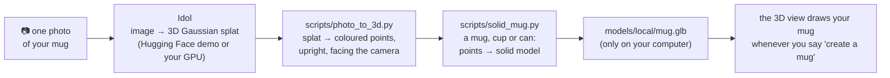

# Your own objects, from photos

Put your own mug, or any small object, on the robot's table: a photo becomes its 3D model, from
a file or live from the webcam. Four photos of its sides, or a short video of one turn, show
Idol the back too, instead of letting it invent it.
The photo is turned into 3D by **Idol**, an open image-to-3D model by Speridlabs
([research page](https://speridlabs.com/research/idol) ·
[code](https://github.com/speridlabs/idol-sdk) ·
[demo](https://huggingface.co/spaces/speridlabs/idol)).



## How it works

1. **Idol** turns one picture into a 3D Gaussian splat: a few hundred thousand small, soft,
   coloured blobs that together look like the object from every side, including the sides the
   photo does not show (Idol invents them).
2. **`scripts/photo_to_3d.py`** turns the splat into coloured points. It drops faint and oversized
   blobs and stray points, stands the object upright on its footprint, turns the photographed side
   towards the camera of the recording view and writes `models/local/<name>.glb`.
3. **`scripts/solid_mug.py`** makes round things solid. Up close, points are scattered dots with
   gaps where no photo looked. For an object named like a mug, cup, can or drink whose points do
   look like a cylinder, it builds a cylinder of the points' radius and height instead, wearing
   the points unrolled around its axis as a texture (the sides no photo saw get the object's own
   dark colour), with a rim, an inside, a bottom and, if points stick out, a handle tube fitted to
   them. `--points` keeps the points; `python3 scripts/solid_mug.py models/local/mug.glb` makes an
   existing point model solid (keeping a backup in `models/local/backup/`). The scanner does the
   same by itself (`SOLID=0` turns it off).
4. **The robot** looks for `models/local/<name>.glb` before its own models. The browser draws a
   solid model as it is, and points with a dark core inside, so the gaps between them show the
   object, not the table.

The look changes, the physics do not: the robot still plans and grasps with the object's simple
shape from the catalogue (a mug is a cylinder 6 cm wide and 7 cm tall, see
`move_the_bot/world.py`), and the model is scaled to that height.

## Step by step

**With the script**, which sends the photo to Idol's public demo:

```bash
pip install numpy scipy pillow gradio_client
python3 scripts/photo_to_3d.py --image my-mug.jpg --name mug
./run.sh --rebuild
```

Then say or type "create a mug". `--gaussians 524,288` asks for more detail.

**With the demo in your browser**, for example when its free quota for anonymous use is spent
(see below): open the [demo](https://huggingface.co/spaces/speridlabs/idol), upload the photo,
choose **Real photo**, run it and download the `.ply` file. Then:

```bash
python3 scripts/photo_to_3d.py --ply ~/Downloads/idol-seed42-262144.ply --name mug
./run.sh --rebuild
```

**On your own GPU**, with the [Idol SDK](https://github.com/speridlabs/idol-sdk) (about 7 GB of
video memory; the first run downloads the weights, which needs access to DINOv3 and FLUX.2 on
Hugging Face):

```bash
python -m idol.sample --image my-mug.jpg --mode real
python3 scripts/photo_to_3d.py --ply my-mug.ply --name mug
```

Splats of several photos, each a quarter turn further round, are fused into one (see
[Several photos, one object](#several-photos-one-object)):

```bash
python3 scripts/photo_to_3d.py --ply front.ply left.ply back.ply right.ply --name mug
```

## Scan with the webcam (optional)

The same idea, live: show an object to the webcam and it joins the table. It is off by default;
start it with:

```bash
./run.sh --scan
```

A **📷 Scan** button appears next to Stop.

1. Click it and hold the object inside the square, ideally in front of a plain background.
2. Type what it is ("stapler") and how tall it is: a photo cannot tell how big something is.
   Width and depth follow from the model's proportions.
3. Choose what the camera takes:

   | | What you do | Idol on an RX 9070 XT |
   |---|---|---|
   | **1 photo** | hold it still | about 50 s; the back is invented |
   | **4 sides** (default) | after each photo, turn it a quarter turn, always the same way; the next photo comes after a 4 s countdown | about 3½ min |
   | **Video** | turn it slowly once all the way round, in about 8 s; the sharpest frame of each quarter is used | about 3½ min |

4. Start. A countdown leaves time to hold the object up, the photos appear as thumbnails, and
   the panel shows what the GPU is doing ("Idol: photo 2 of 4… 61 s"). Then the page says
   "create a stapler"; afterwards "create a stapler" works any time, without scanning again.

**Starting without the mouse.** Any of these starts a scan, and while the photos are being taken
Space or "next" takes the next one straight away:

- the **Space** key (when the panel is open and you are not typing);
- a **thumbs-up 👍** to the camera, held for half a second (the hand tracking of
  [hand control](../README.md), in the browser);
- **saying or typing "scan …"**: "scan my mug", "scan a stapler, 8 cm" opens the panel with the
  name (and the height) filled in and starts at once; "cancel" closes it.

With `?rec` (recording mode), the scan shows in the diagram too: the photos in the "You" box,
then Idol's progress, photo by photo, in the GPU PC's box.

A scan that went wrong (your face behind the object, say) is forgotten with the ✕ next to it under
"Your scans" in the scan panel, or by saying or typing "delete the mug scan": the object leaves
the table, and "create a mug" draws it as before the scan. The scan server's `GET /scans` lists
the scans and `DELETE /scans/<name>` forgets one. Hold the object at arm's length, in front of a
plain wall, so the camera sees nothing else behind it.

The robot plans and grasps a scanned object as a box of that size, so objects up to about 9 cm
across fit its gripper. A scan with the name of a built-in object ("apple") replaces the built-in
model. Between a scan and your own `models/local/<name>.glb`, the newer one wins: scan "mug"
again and the scan replaces your mug model; copy a model in afterwards and it replaces the scan.

### Where Idol runs

| `IDOL_BACKEND` | Where Idol runs | Needs |
|---|---|---|
| `demo` (default) | Idol's public demo on Hugging Face | the internet; a short free daily quota, more with `HF_TOKEN` in `.env`. One photo per scan, to spare the quota |
| `remote` | a scan server on a GPU PC in your network, at `IDOL_URL` | that PC: the Idol SDK and about 8 GB of video memory |
| `local` | inside the scanner container | a GPU the container can use and the Idol SDK installed (not in the default image) |
| `file` | nowhere: always the splat at `IDOL_FILE` | nothing; for tests and offline demos |

### Why not Ollama

Ollama serves language models (GGUF files run by llama.cpp). Idol is a different kind of model: a
diffusion transformer with an image encoder, a background remover and decoders that output 3D
Gaussians, all in PyTorch. So it gets its own small server, which you can run next to Ollama on
the same GPU PC.

### A scan server on your GPU PC

[`docker/idol-server/idol-server.sh`](../docker/idol-server/idol-server.sh) sets one up next to
Ollama, the same way [`ollama-server.sh`](hardware-and-gpus.md#a-gpu-pc-in-your-network) does: a
container with PyTorch for your AMD GPU (ROCm), Idol and this project's scan server, run by Podman
as a system service on port 8001. Written for Bazzite; other Linux systems with Podman work too.

1. With your Hugging Face account, accept the terms of the two models Idol reads images with,
   [DINOv3](https://huggingface.co/facebook/dinov3-vith16plus-pretrain-lvd1689m) and
   [FLUX.2-dev](https://huggingface.co/black-forest-labs/FLUX.2-dev) (only its VAE is used; check
   both licences for your use), and create a read token at
   [huggingface.co/settings/tokens](https://huggingface.co/settings/tokens).
2. On the GPU PC:

   ```bash
   curl -fsSLO https://raw.githubusercontent.com/gabripo/move_the_bot/master/docker/idol-server/idol-server.sh
   bash idol-server.sh install        # builds the image (several GB, once) and starts the service
                                      # now, not at boot (--boot for that)
   idol-server login                  # paste the token
   idol-server test                   # the first run also downloads Idol (about 3 GB)
   ```

   `IDOL_GFX` selects the GPU family (default `gfx1201`, the Radeon RX 9070 series; `gfx1100` for
   the RX 7900 series).
3. On the computer that runs move_the_bot, in `.env` (the address `idol-server test` prints):

   ```bash
   IDOL_BACKEND=remote
   IDOL_URL=http://192.168.1.50:8001
   ```

   Then `./run.sh --scan`.

The GPU is shared: before each scan the server asks Ollama on the same PC to unload its model
(a 14B model and Idol do not fit together in 16 GB; the next language request loads it again),
and after the scan it frees the video memory, so games get it back. Like Ollama, the server has
no password: use it only in a network you trust. Idol's authors run it on NVIDIA GPUs and Apple
Silicon; on AMD GPUs its NVIDIA-only speed-ups are switched off (`IDOL_OPTIMIZE=auto`).

### Switching all AI off on the GPU PC

When the PC is for games, [`docker/ai-switch/ai-switch.sh`](../docker/ai-switch/ai-switch.sh)
switches both servers, Ollama and the scan server, off and on together:

```bash
curl -fsSLO https://raw.githubusercontent.com/gabripo/move_the_bot/master/docker/ai-switch/ai-switch.sh
curl -fsSLO https://raw.githubusercontent.com/gabripo/move_the_bot/master/docker/ai-switch/ai-switch-tray.py
bash ai-switch.sh install     # `ai-switch`, the Gaming Mode default, a launcher and the tray icon
```

**AI is off by default:** after `install` nothing AI starts with the PC, so games and the desktop
get the whole GPU until you switch it on (the tray icon, or `ai-switch now`).
`ai-switch default on` makes both start with the PC again.

In **Desktop Mode** an **AI** icon sits in the system tray, next to the clock: green while
anything AI runs, grey when all is off. Click it to switch everything on or off; right-click it
to switch the language model or the scan server on its own and to see what runs. It asks first
if switching off would stop a scan in progress. It starts with Desktop Mode by itself
(`ai-switch tray` starts it by hand) and needs no password.

| Command | What it does |
|---|---|
| `ai-switch now` (or just `ai-switch`) | on if all is off, off if anything runs: right now, the boot settings stay; no password |
| `ai-switch off` | both stopped, neither starts at boot: nothing uses ROCm any more; lists any other program still holding the GPU's compute device |
| `ai-switch on` | both back, with the start-at-boot settings they had before `off` |
| `ai-switch default off` (the default) / `on` | nothing AI starts with the PC (switch it on when needed) / both start with the PC; nothing starts or stops now |
| `ai-switch gaming-mode off` (the default) | entering Steam's **Gaming Mode** stops both; **Desktop Mode** starts again those set to start at boot |
| `ai-switch gaming-mode keep` | switching modes changes nothing |
| `ai-switch status` | what runs, what starts at boot, the Gaming Mode setting, who uses the GPU |
| `ai-switch tray` | the tray icon of Desktop Mode (it starts by itself with Desktop Mode) |

So a PC that starts in Gaming Mode has the whole GPU for games, and the AI comes back in Desktop
Mode. To use it from Gaming Mode anyway, add the launcher **AI services on/off** (it runs
`ai-switch now`) to Steam with "Add a Non-Steam Game" and start it from the library: it needs no
keyboard and no password. That works because `install` adds a polkit rule letting your user,
and only it, start and stop these two services; everything else (`on`, `off`, `gaming-mode`)
still asks for the password. While the AI is off, the robot's computer shows no Scan button and
the robot answers with its built-in rules only.

### Several photos, one object

Idol makes a whole object from each photo; what differs is which side it really saw. The scan
server (or `photo_to_3d.py` with several `--ply`) puts them together:

1. Each splat is scaled to the same height and stood on the same footprint, or centred on its
   body when a hand under it makes the footprint wider than the object.
2. **How far was it turned?** Each photo against the one before: every turn within 30° of a
   quarter turn is tried, and the one where the shapes match best wins, the colours counting only
   where both photos really saw the surface (Idol invents the rest). Both directions are tried;
   the better one says which way round the object went.
3. **Loop closure.** Four quarter turns make one full turn, so the turns found must add up to
   360°; the difference is shared out between them.
4. Each point is kept from the photo that saw its side most directly.

Tried on four renders of a model whose true angles are known: one photo invents a second front
on the back; four photos show the real back, and the angles come out within about 15° of the
truth (`tests/unit/test_scan_server.py` and `test_photo_to_3d.py` check the same with synthetic
views).

### Hands

You hold the object, so your hands are in every photo, and SAM 2 easily keeps them as part of it.
The browser's hand tracker (the same one as hand control) notes where both hands are in each
photo, and the scan server uses that twice: the wrist, palm and fingertips are told to SAM 2 as
"not the object", and what is left of the hands (their outline, grown a little) is erased from
the cut-out. Idol fills in what the fingers hid. Holding the object by its top and bottom, not
around its middle, still helps.

### Cans: wrapped, not Idol

A can is a cylinder, so it does not need Idol at all: its photos only have to tell how wide it is
and what its label looks like. A scan named like a can or another drink ("monster drink", "coke
can": `solid_mug.CAN_WORDS`) goes another way, when SAM 2 is there (`IDOL_BACKEND=remote` or
`local`):

1. **Cut out.** The GPU PC's scan server answers `POST /cutout` with SAM 2's cut-outs, hands
   erased. SAM 2 is small: the language model stays loaded, and it takes seconds.
2. **The can in each photo.** The rows as wide as the body around the middle of its height give
   its left and right edges, its top and its bottom (a hand under it is not as wide; skin colours
   that reach out of the can are not the can).
3. **Wrapped.** A column of a photo at s (-1 left, 1 right) shows the label at the angle asin(s)
   from the photo's direction, so the photos, a quarter turn apart, are unrolled side by side
   around a cylinder of the measured proportions; where they overlap, the one seeing it more
   head-on counts more. Both ways of turning are tried, and the one whose overlaps agree wins.

The label comes out as sharp as the photos, and the scan takes seconds rather than minutes.
`WRAP=0` sends cans to Idol like anything else; mugs (a handle) always go to Idol.

### Testing the scanner

Without Idol: a synthetic splat stands in for it, so the camera, the upload, the conversion and
"create a …" are all tested (GitHub does this on every pull request).

```bash
python3 tests/e2e/make_test_splat.py test-splat.ply
docker compose cp test-splat.ply robot:/models/cache/test-splat.ply
IDOL_BACKEND=file IDOL_FILE=/models/cache/test-splat.ply docker compose --profile scan up -d --build scan
cd tests/e2e && CHECK_SCAN=1 node browser_test.mjs
```

## A good photo

- One object, the whole of it, on a plain light background, evenly lit. A shop's product photo
  works well.
- From the side, at about the height of the object's middle. For a mug, the handle to one side.
- About 1000 pixels across the object is plenty: Idol works at roughly that size.

## Good to know

- **With one photo, the back is invented.** A print on the front may come back on the back as
  well. Four sides or a video avoid it.
- **Your drinks come first.** Scanned objects are named to the language model as the user's own,
  and anything named like a drink (a "monster drink", a "coke can", a mug) is listed best first:
  scanned drinks on the table, scanned drinks to create, then the other drinks. "I'm thirsty"
  brings the first of them to the front of the table.
- **Mugs, cups and cans are solid; other things are points.** A stapler or a teapot is not a
  cylinder, so it stays a cloud of points (see `scripts/solid_mug.py`).
- **Free demo quota.** The demo runs on Hugging Face's shared GPUs, which give a short daily
  quota to visitors who are not logged in; a run asks for 3 minutes of it. Logged in to Hugging
  Face in your browser you get more, or run Idol on your own GPU.
- **Turning it.** `--yaw` turns the photographed side (default: towards the recording camera of
  `?rec`); `--min-opacity` keeps fewer, more solid points (higher) or more, fainter ones (lower).
- **Keep it on your computer.** `models/local` is never committed. Photos and models of branded
  products, such as a mug with licensed artwork, are fine for your own demo but do not belong in
  a public repository.
